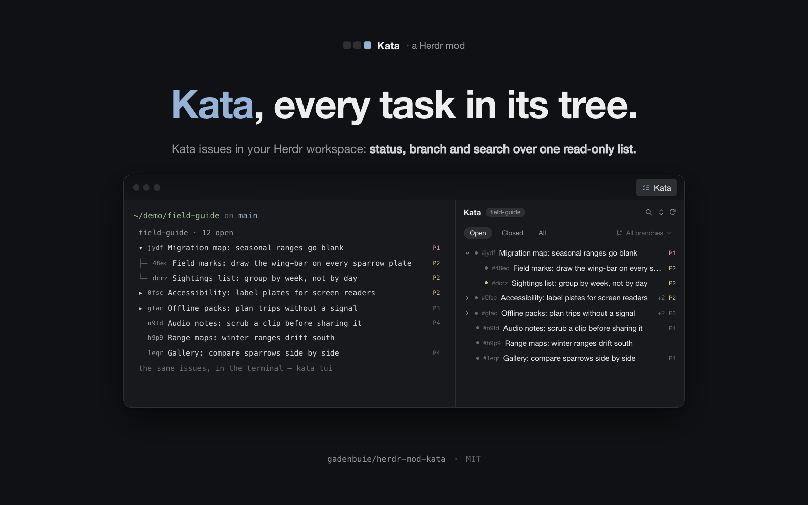
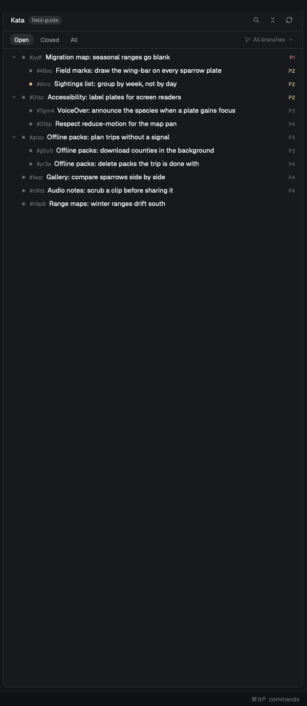

# Kata

A [Herdr](https://herdr.dev) panel (`herdr-app`; written against 0.1.12) that
shows the space's [kata](https://katatracker.com) issues as a read-only tree:
the open work of the project you are in, which task belongs under which, with a
status filter, a branch filter that follows the checkout, a search over ids,
titles and bodies, and a detail view per issue. With the
[tab-host](https://github.com/gadenbuie/herdr-mod-tab-host) mod it also gets a
**Kata** button beside Files and Changes, which opens it as a tab in the side
panel.



The preview above is drawn. This is the panel as the app really renders it —
a made-up project on a real checkout, photographed:



It is a [tab-host](https://github.com/gadenbuie/herdr-mod-tab-host)
contributor: a Herdr mod of its own whose `mod.json` declares one `tab`, which
tab-host reads to draw the button and add the mod's block to the side panel's
stack. Nothing in this repo touches tab-host, and there is no build step: the
manifest is the whole contract.

```json
{
  "place": "none",
  "title": "Kata",
  "tab": {
    "title": "Kata",
    "icon": "mods/kata/icon.svg",
    "state": "kata.state",
    "show": "command -v kata >/dev/null 2>&1"
  }
}
```

| Field | What it does |
| ----- | ----------- |
| `place` | `"none"` — tab-host's stack is the only place a copy shows. |
| `title` | The name Herdr lists the mod under. |
| `tab.title` | The button's label. |
| `tab.icon` | The button's glyph; `*.svg` draws tinted with the text color. |
| `tab.state` | The `shared()` key (`kata.state`) the panel keeps what the space was left showing in: the status and branch filters, the open issue and the trail behind it, the folded rows. tab-host holds one value of it per space, so switching spaces hands the arriving one its own back — the Kata tab picks up where that space left off, and a space never visited starts fresh. Written only from the panel's own doings (clicks, picks); the search field and the open branch chooser are this minute's doings and stay out of it. |
| `tab.show` | A shell string, run as `sh -c` in the shown space's folder on that space's machine; exit 0 draws the button. Only spaces whose machine has `kata` get a Kata tab, rather than one that could only say so. |

## What it shows

- **The tree**, refreshed every 15 s (`kata tui`'s own pace) and on the ↻
  button: open before closed, then priority, then what moved last, with ready
  open tasks above blocked ones and a task below the open sibling that blocks
  it. A parent
  folds, its `+N` counts every task under it, an open task blocked by another
  open one carries an amber marker, and a closed one a check in the theme's
  `done` color.
- **The branch filter, on the checkout's side.** On the repo's own branch
  every task shows; on any other branch — a worktree, a topic checkout — the
  tasks recorded on that branch show, and a default that matches nothing falls
  back with a line saying so. A pick in the list is yours and is kept for that
  checkout.
- **The search**, over ids, titles and bodies of the rows in hand — one pass,
  no second read. Hits in ids and titles sit above hits in bodies, a body hit
  carries the line that matched, and a search that finds nothing says what it
  searched and offers the one click that widens it.
- **The detail view**: status, priority, owner, author, branch, labels, age,
  parent and children as chips, blocks/blocked-by/related, and the body as
  rendered markdown. Following chips leaves a trail; `‹` walks it back naming
  each issue, `All issues` returns to the tree.
- **Work state**: kata has only open and closed, so the state is read from
  what the workflow leaves. In flight: an owner (`kata claim`) or a
  `work.attention` value — a blue dot, red for `stuck`, purple for
  `needs-human`. Backlog: the `backlog` label or `someday` metadata — a gray
  outline circle. Blocked by an open issue, or a parent whose open children are all blocked — a gray outline square. Anything
  else open is ready — a gray filled circle. The marker is before each row, on
  the graph's cards and in the detail pill. Gray is quiet on purpose: most work
  is not ready, and ready and in-flight are what to find.
- **Metadata and comments** in the detail view: every metadata key but
  `work.branch` (which is the Branch row) as a field row at the bottom of the
  info block, after a `Metadata` heading, plus the issue's comments, oldest
  first, with author, age and rendered markdown. The thread comes from
  `kata show` when an issue opens and again on each refresh.
- **The graph**: the graph button in the detail header opens a window over the
  app with that issue's neighbourhood — parent, blocks and related links, one
  to three hops out (`Hide done` drops closed issues) — laid out in columns,
  blockers and parents to the left. Clicking a node opens that issue in the
  panel and closes the window. It is this same mod opened with `openOverlay`,
  so it needs nothing in `mod.json`.
- **Honest empty states**: a folder with no kata project says so and shows the
  `kata init` that would bind it; a read that stopped at its ceiling says
  `N of M` and offers **Load more**; a space on a machine without `kata` says
  that, not another machine's issues.

## The branch default

`data/kata/settings.json` (under Herdr's home) sets what the branch filter
starts on — one key, no UI:

| `branchFilter` | What it means |
| -------------- | -------------- |
| `"auto"` | The default, and what a missing or broken file means: the checkout's own answer, with a fallback to every branch when it matches nothing. |
| `"all"` | Never filter by branch; a checkout does not change the list. |
| `"branch"` | Always filter by the space's branch, even on the trunk, and never fall back — an empty tree means an empty branch. |

## Install

The panel reads [kata](https://katatracker.com) — the local-first issue
tracker for coding agents — so install it where you want the button
(`brew install kata` on macOS; the site has Linux and Windows installers).
The button and the tab themselves come from
[tab-host](https://github.com/gadenbuie/herdr-mod-tab-host) — install that
first if you don't have it (its `install.sh` copies the mod and wires every
personal layout's tab bar):

```sh
git clone https://github.com/gadenbuie/herdr-mod-tab-host.git
cd herdr-mod-tab-host && ./install.sh
```

Then this mod. Herdr does not run a mod that lives behind a symlink, so
installing is a copy:

```sh
git clone https://github.com/gadenbuie/herdr-mod-kata.git
cd herdr-mod-kata
make install
```

That is `rsync -rlpt --delete mods/kata/ ~/.config/herdr-app/mods/kata/`
followed by `herdr-app check` on the copy (set `DEST=` to install
somewhere else).

tab-host watches `mods/`, so the **Kata** button appears at the right end of
the tab bar the moment the copy lands, and both the button and the panel go
when the folder does. With tab-host, using it is one click: the button opens
the side panel on the Kata tab, the same button (or the key below) puts it
away — and after the first click the panel keeps itself fresh in the
background, so reopening it shows a list that is already up to date.

## Without tab-host

`place: "none"` keeps the mod out of the window on its own, and the tab
declaration is inert without tab-host. The second door is a pane:

```sh
herdr-app do pane.split '{"direction":"right","mod":"kata"}'
```

## Keys

Nothing to bind here. A key can reach the tab through tab-host —
`"cmd-alt-shift-k": "tab-host.toggle:kata"` in `keys.json` opens the tab or
puts it away — which is why this mod binds none of its own: a hidden tab's
copy is asleep, which is exactly when a key would be pressed. The panel takes
no focus handle either, so no click here ever pulls keys out of the terminal;
the search field is the one deliberate exception.

## Files

- `mods/kata/main.js` — one `View`: place resolution, the read, the tree, the
  search, the trail between issues, the drawing. The copy holds nothing that
  has to survive it: what a space was left showing lives in the shared key
  `kata.state`, which tab-host keeps per space.
- `mods/kata/mod.json` — the manifest, quoted verbatim above.
- `mods/kata/*.svg` — the tab icon and the panel's icons, all one-color so
  they tint with the theme.
- `assets/` — the drawn preview and the HTML it was rendered from.

**RECIPE.md** is the brief to build the whole mod from scratch, in the shape
Herdr shares: what you see, how it behaves, what it is built from, what to
watch out for, and what proves a build done.
