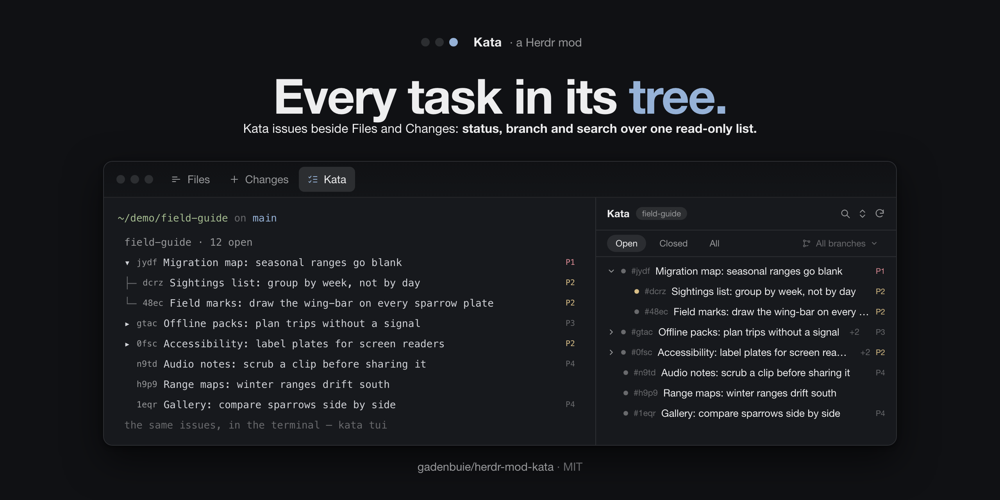
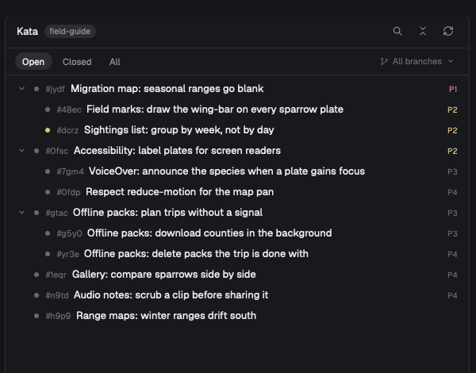
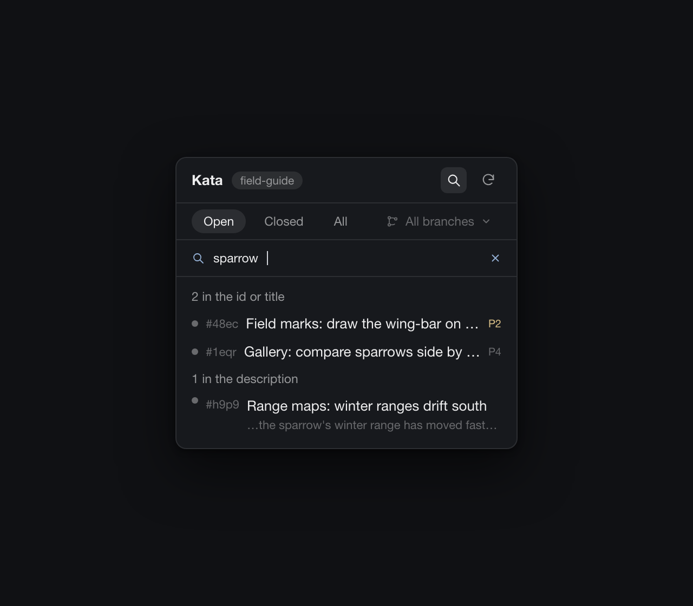

# Kata

A **Kata** button in the tab bar — beside Files and Changes — opens a tab in
the side panel that shows the space's kata issues as a tree: the work that is
open, which task belongs under which, and a detail view per issue, with a
status filter, a branch filter, a search over ids, titles and bodies, and
foldable parents. It is a window onto the same list `kata tui` shows, sized
the way a 368 px side panel can take it.



The preview above is drawn; this is the panel as the app really renders it
(`assets/panel-real.png`, a made-up project on a real checkout):



## What you see

The panel is a card of its own in the side panel — 368 px wide in the
person's layout, the width Files and Changes get — rounded 10, `background`
fill, a 1 px `border`, at 13 px in `foreground`:

```
Kata  [field-guide]                       🔍 ⤢ ↻
[Open] [Closed] [All]          [ All branches ▾ ]
────────────────────────────────────────────────
▾ #jydf  Migration map: seasonal ranges go…   P1
   ● #dcrz  Sightings list: group by week, …  P2
   ● #48ec  Field marks: draw the wing-bar …  P2
▸ #gtac  Offline packs: plan trips without…    P3 +2
▸ #0fsc  Accessibility: label plates for…    P2 +2
   ● #n9td  Audio notes: scrub a clip before… P4
   ● #h9p9  Range maps: winter ranges drift…
   ● #1eqr  Gallery: compare sparrows side…   P4
```

**Header**, 42 px, 14 px side padding, a 1 px bottom border:

- "Kata", 13 px semibold, then the project's name on a `raised` chip (10.5 px,
  fully rounded, 6 px side padding, at most 170 px, ellipsis). `muted` when
  kata itself would find the project; `dim` when the name was guessed from
  the repo, with a tooltip that says which: `The bound kata project`, or
  `No kata binding here: the git repo's name, <name>`.
- Icon buttons at the right, 24 px each with a 14 px glyph in `muted`,
  `foreground` on `hover`, each with a tooltip — but only the ones with work
  to do:
  - **↻**, always drawn, which turns while a read is in flight (`.spin(900)`,
    drawn by GPUI, no timer of ours).
  - **search** (a magnifier; filled `selected` while its field is open) only
    while there is a list on screen — behind an open issue, over a note,
    over an empty tree, or while the first read is still in flight there is
    nothing to search.
  - **fold/unfold all** (one button for both) only while the tree has
    something foldable: with anything folded it unfolds; with everything open
    it folds every parent. It goes while a search has flattened the tree into
    results.

**Filter row**, 34 px, a 1 px bottom border:

- Three pills, 22 px, rounded fully, 11.5 px: **Open**, **Closed**, **All**.
  The chosen one is filled `selected` in `foreground`; the others are `muted`
  and fill `hover`. A pick re-reads with that status and closes the detail
  view.
- On the right, the **branch filter**: a 22 px rounded-6 button with a branch
  glyph, the branch it means, and a chevron. "All branches" — and "No branch" —
  is drawn `dim` when it means every branch; a branch's own name is `muted`.
  It is filled `selected` while its list is open. Clicking it opens the branch
  list; it does not float, it replaces the tree — a panel with one scroll area
  stays one scroll area.

### The branch filter, and the default it starts on

It opens on the checkout's own answer, not on "everything":

- **The branch is the space's, live from Herdr** (`panes()[…].branch`, else
  the space's), so a `git checkout` is noticed within a second without running
  anything, and nothing has to poll `git`.
- **On the repo's own branch, every task shows.** The trunk is what
  `origin/HEAD` names, falling back to `main`/`master`/`trunk` when the clone
  does not record it. A checkout of `main` is not about one branch, so scoping
  it would hide the work.
- **On any other branch, that branch's tasks show** — a worktree or a topic
  checkout is about that branch, and the tasks recorded on it (`work.branch`
  metadata) are the ones being worked there.
- **A default that matches nothing falls back to every branch**, with a line
  above the tree: `Nothing on feat/migration-map — showing every branch`.
  Work recorded under another name should not open as an empty panel, and the
  line keeps the fallback from looking like an empty project.
- **A pick is the person's, and it is kept**: picking a branch or "All
  branches" in the list overrides the default for that checkout, and is kept
  even when it matches nothing (the empty tree offers "Every branch" in one
  click). Picks are keyed by folder *and* branch, so checking out another
  branch offers the default again instead of an old branch's filter. Only the
  *automatic* default falls back when the next read no longer has the branch;
  a pick that no longer matches keeps its empty tree and its one-click way
  out.

`data/kata/settings.json` sets what the default is — one key, no UI:

```json
{
  "branchFilter": "auto"
}
```

- `auto` (the default, and what a missing or broken file means): as above.
- `all`: never filter by branch; a checkout does not change the list.
- `branch`: always filter by the space's branch, even on the trunk, and never
  fall back — an empty tree then means an empty branch.

The file is this machine's and is re-read on every refresh, so an edit lands
within 15 seconds with no button to press.

**The branch list** (while it is open): 26 px rows, 6 px side margins, 10 px
padding, rounded 6, `hover` fill, the name at 12 px `muted` and its task count
at 10.5 px `dim` on the right. "All branches" first (with the whole read's
count), then every branch the current status has, most tasks first, then "No
branch" for the tasks whose metadata has none. Picking one closes the list.
Branches come from each issue's `work.branch` metadata — the key kata's own
examples use — and hand-quoted values (`"feat/x"`) count as the same branch as
the unquoted ones.

### The search

The magnifier in the header opens a **search field** under the filter row:
34 px, the same 1 px bottom border as the rows above it, a 12 px magnifier
glyph that turns `accent` while the field holds the keyboard, the input at
11.5 px, and a `×` at the right that empties it. Opening the field asks kata
for nothing and closing it puts the tree back as it was; an empty field is the
tree, so emptying it and closing it are the same picture. The field only opens
while there is a list on screen — the magnifier is gone when there is nothing
to search.



- **What it matches**: a substring, case-insensitive, anywhere in an issue's
  id, title, or body — the three strings `kata list --json` already carries,
  so a search is one pass over the rows in hand and never a read. `48ec` and
  `#48ec` both name `#48ec`, and a query with a `#` inside it may name the
  qualified id (`field-guide#48ec`). No fuzzy matching, no ranking by distance:
  a typo finds nothing.
- **The id and the title come first.** Results are drawn in two groups, `N in
  the id or title` and then `N in the description`, so the rows the query
  *names* sit above the rows it is merely written in. Within a group the tree's
  own work order holds — open before closed, then priority, then what moved
  last — because a search is still a list of work to do rather than a list of
  scores. An issue whose title matches is in the first group even when its
  body matches too.
- **A description hit says why it is there**: one dim line under the title,
  the words around the match lifted out of the body with its whitespace
  collapsed and both ends ellipsized to a single line — about 24 characters of
  lead-in, in a line about 84 wide. A page of markdown answers "why is this
  here?" with a paragraph; the line that matched answers it with the words
  that matched.
- **Results are a list, not a tree.** No indent, no fold chevron, no context
  parent: where an issue sits is not what the person searched for. A row is an
  ordinary row otherwise — marker, `#ref`, title, priority — and still opens the
  issue. The fold/unfold button goes while results are drawn, since a flat list
  has nothing folded, and comes back with the tree.
- **The filters above still hold.** A search narrows the list the status and
  branch filters made rather than reaching around them, so the read stays one
  read and the counts stay the filters' own. A search that finds nothing says
  what it looked at — `Searched the open issues — Closed and All search the
  rest.`, or `Searched every issue on feat/migration-map.` — instead of declaring
  the task gone, and while the status is not **All** it offers the one click
  that widens the search: a `Search all statuses` row, a magnifier and 11.5 px
  `muted`, hovered like a row of the tree. It is the same shortcut the tree's
  empty state gives a branch, and the same `setStatus` the pills run — a person
  reading "nothing matches" should not have to work out which pill would have
  found it. A read that stopped at its ceiling keeps its `N of M` line and its
  **Load more** row under the results.
- **Opening it takes the keyboard, on a click.** The field is the one thing in
  this panel that ever holds it (see *How it behaves*); the `×` empties it and
  keeps the field and its focus, so the next search is one keystroke away, and
  the magnifier closes it.

A query belongs to the place like the rest of the panel: another space or `cd`
closes the field and drops the query, while a re-read of the same place — the
15 s timer, ↻ — keeps both, because the person is still looking for the same
thing.

**The tree**, one scroll area, 26 px rows, 6 px side margins, rounded 6,
`hover` fill:

- Indented 8 px + 14 px per level (up to 8 levels), then a 14 px fold chevron
  — an 11 px glyph in a 14 px hit box — on a row that has children (a button
  of its own: clicking it folds, and it stops the mouse-down so the click does
  not also open the row), then a marker, the `#ref` at 11 px in `dim`, the
  title, and the priority.
- The marker is a filled circle at 6 px: `ansi3` (amber) when an open issue
  is blocked by another open one — its tooltip says `Blocked by an open issue`
  — else `dim`. A closed issue gets a check-circle in the theme's `done` color
  instead (blue in Herdr's dark theme), and its title turns `muted`.
- The title truncates; if it is the row's only content, the row is still
  clickable edge to edge.
- The priority chip (`P0`…`P4`), drawn only when the issue carries one, is
  10 px, `ansi1` for P0/P1, `ansi3` for P2, `dim` above that — the queue's own
  emphasis.
- A folded row carries `+N`, N being every task under it, not just its
  children.
- Siblings sort by work order: open before closed, then priority (unset
  last), then most recently updated.
- **A task always hangs from its parent.** When a filter keeps the parent out
  of the read, or out of the branch, the parent comes back as a **context
  row**: same 26 px row, same fold chevron, `muted` title, and a tooltip saying
  why it is there. Context rows are not counted as tasks of the read — the
  branch counts and the read count are the filter's own — so the tree shows
  `#gtac Offline packs: plan trips without a signal +2` above the two tasks
  that belong to it without pretending the parent is on that branch. A parent
  whose own parent is out of the read pulls that one in too, so the chain to
  the top is whole. Two tasks each claiming the other as parent — the data can
  be malformed — are both drawn as roots rather than vanishing. A task whose
  parent cannot be had at all is the one other case drawn as a root.
- **Nothing under the tree is said about a filter.** A branch filter hides the
  other branches' tasks on purpose and every task of the shown branch is drawn,
  so a count of both populations (`16 of 49 on this branch filter`) only asks
  where the other 33 went — the answer is "on other branches", which the branch
  button already says. The line under the tree appears for one thing only: a
  read that stopped at its ceiling, where a task of *this* branch genuinely may
  be one of the rows not fetched. It says `1000 of 1200 in this project`, adds
  `— more may be on <branch>` when a branch filter is on, and a **Load more**
  row sits under it: one click re-reads the list at the next ceiling
  (`bigger`). The rows on screen stay while it runs, so the click is safe
  twice, and its tooltip says what the next read will ask for.
- An empty read says so in the panel's own words — `No issues here`,
  `Nothing closed yet`, `No open issues on <branch>.`, `No open issues
  without a branch.` — rather than drawing nothing, and a filter the panel
  guessed offers "Every branch" as a row in that space.

**The detail view** — a row's click — takes the whole panel, under a 28 px nav
row with the two ways out of it:

- **`‹ #ref title`** — back one step along the trail, naming the issue it
  returns to. A chain of refs is easy to follow and hard to remember, so back
  says where it goes, and its tooltip adds how many steps are behind that one
  (`Back to #dcrz — Sightings list: group by week (1 more behind it)`). On the
  first issue opened from the tree there is nothing behind it, so the same
  button reads `‹ All issues` and shows the tree: a "back" that goes where
  "all issues" goes is one button, not two.
- **`☑ All issues`**, at the right, drawn only when there is a trail: the whole
  tree, with the trail behind it cleared however deep it was. Its 11 px glyph
  is the tab's own list icon.

Under the nav row, the issue itself:

- `#ref`, a status chip (`open`, or the close reason — `done`,
  `duplicate`…, on a `done` fill), and the priority.
- The title, semibold at 13.5 px, wrapping.
- Owner, author (when they differ), branch, labels, how long ago it changed
  (now, minutes, hours, days, weeks), the parent as a chip that opens it —
  whenever the panel knows the parent: a row of this read, or one fetched into
  the tree with `kata show` — and the refs of its children.
- The description as **markdown**, kata's own body, rendered by `TextView`
  (`gpui-base`): kata bodies are plans and requirements, and they read as text,
  not as an escaped string.
- Blocks / Blocked by / Related as wrapping chips. A ref the panel has read
  opens; the rest are text, in `dim` when the issue is closed, because the
  panel only knows what one list told it.

**The placeholder** for a space with no kata project is the header and one
centred note: "No kata project here", the folder, and
`kata init --project <repo>`. A read that could not happen — no `kata` on that
machine, the daemon down — is the same note with kata's own message, and the ↻
above it retries. A read that fails *with rows already on screen* is an error
line in `blocked` above them, never an empty panel.

## How it behaves

- **Read-only, deliberately.** It writes nothing — no claim, no close, no
  comment, no edit — and the only reads are one `kata list` per refresh plus a
  `kata show` for each parent that list did not carry. A search costs no read
  at all: it is a pass over the rows already in hand. Adding writes would need
  a claim flow, an actor, and a confirmation for the destructive ones; that is
  a different mod, and a person can do all of it from `kata tui` in a terminal.
- **One read per refresh, on a 15 s timer** — `kata tui`'s own pace — and on
  the ↻ button, which also forgets which project the place is, so `kata init`
  shows up on a click instead of on the next space change. There is no file to
  watch: issues change from terminals, agents and the CLI. Rows stay on screen
  while a read runs and after one fails.
- **The branch filter follows the checkout.** A space on the repo's own branch
  (`main`, or whatever `origin/HEAD` says) is not about one branch, so every
  task shows; a space on any other branch — a worktree, a topic checkout —
  shows the tasks recorded on that branch, which is the work being done there.
  A pick in the branch filter wins over that default for that checkout, and
  `data/kata/settings.json` can turn the default off or make it strict. A
  checkout is a filter change, not a read: the 1 s watcher reads the space's
  folder, machine and branch from Herdr and does nothing at all unless one of
  them moved; a moved folder re-reads, a moved branch only redraws.
- **Nothing is polled from Herdr.** Spaces, focus, panes and the theme come
  from `spaces()`, `focused()` and `panes()`, and Herdr re-renders the mod when
  they change. The one-second watcher reads only to notice a `cd`, and
  redraws nothing unless the answer changed.
- **One read at a time.** Every read takes a generation number and an older
  answer that lands late is dropped, so a status click during a slow read
  cannot paint the old filter's rows under the new filter's buttons.
- **Nothing is remembered once the place moves.** Rows, folds, the open issue,
  the trail behind it and the parents fetched for it all belong to the space
  they came from; switching space, or `cd`-ing to another repo, starts clean.
  State that survives a *re-read* of the same place (folds, an open issue, the
  branch picks, parents a task still points at, the read's ceiling) stays,
  which is what makes the 15 s refresh invisible; an open issue that the new
  read no longer has closes back to the tree, and a parent the new read
  carries itself stops being a fetched copy.
- **The trail is the issues, not a browser history.** Following a ref chip or
  the parent chip is one step further in; opening a row in the tree starts a
  new trail at that row, which is why the tree is always where an empty trail
  ends. `‹` walks the steps one at a time, `All issues` clears them. A status
  pick, a moved place and the ↻ button all forget the trail, and a read that
  no longer has an issue drops that step: the panel never offers a step it
  cannot take.
- **The tab is alive once opened.** tab-host keeps a block's copy while its
  block is in the stack, shown or hidden, so after the first click the 15 s
  read keeps running with the panel collapsed — opening the panel again shows
  a list that is already fresh.
- **It takes the keyboard in one place.** The panel itself takes no focus
  handle — no key handlers, no `focusable` — so clicking a row, a filter or the
  tree does not pull keys out of the terminal, and everything but the search
  is a click. The search field is the deliberate exception: the click on the
  magnifier moves the keyboard onto the input, because a search box you cannot
  type into is not one, and clicking a row, the tree or the terminal takes it
  back. There are still no key handlers of ours, which is why the `×` empties
  a search and the magnifier closes it.

## Built from

### The contract

It is an ordinary tab-host contributor: the whole registration is one field
in `mod.json`, and tab-host draws the button, adds this mod's block to the side
panel's stack, and keeps its width fitted. `mods/kata/mod.json`, verbatim:

```json
{
  "place": "none",
  "title": "Kata",
  "tab": {
    "title": "Kata",
    "icon": "mods/kata/icon.svg",
    "show": "command -v kata >/dev/null 2>&1"
  }
}
```

`place: "none"` keeps Herdr from docking a copy anywhere by itself;
tab-host's stack is the only place it shows. `tab.show` is the one conditional
field: the string is run as `sh -c` in the shown space's folder on that
space's machine, and only exit 0 draws the button — so a space on a machine
without `kata` installed has no Kata tab to click, rather than an empty one.
Nothing here imports from tab-host and nothing breaks without it — but with
`place: "none"` the mod shows nowhere on its own, so the second door is a
pane:

```sh
herdr-app do pane.split '{"direction":"right","mod":"kata"}'
```

The same panel draws beside the terminals then, resolving the project from
that pane's tab. A key can reach the tab without one:

```json
"cmd-alt-shift-k": "tab-host.toggle:kata"
```

That is tab-host's own command (`tab-host.toggle:<mod>`), which does what the
button does — show the panel on this tab, or hide it again. This mod binds
nothing: a hidden tab's copy is asleep, which is exactly when a key would be
pressed.

### Which project it shows

The space's, resolved in three steps, and the panel shows which one it landed
on:

1. **The `.kata.toml` binding at or above the folder the space's focused pane
   is in.** This is kata's own answer, so `kata tui` in that terminal shows the
   same issues. The search walks up to twelve levels, which is what makes a
   space sitting in a subfolder of its repo work, and the project is the
   file's `name = "…"` — the first `name =` line the file carries.
2. **A project named after the repo.** With no binding above the folder, the
   name comes from the folder's `origin` remote —
   `git@github.com:example/demo.git` and `https://github.com/example/demo`
   both give `demo` — else from the folder's own name. That project has to
   exist in `kata projects list`, and among the *active* ones (a project the
   list marks inactive is not a hit); when it does, the panel passes
   `--project <name>` and the chip is dimmed, because the name is a guess that
   happened to be right.
3. **Nothing.** A space with no kata project gets a placeholder and the
   command that would bind it: `kata init --project <repo>`. No filters, no
   tree, no empty box that looks broken.

A space on another machine is resolved and read on that machine
(`exec(…, {on: space.machine})`), so a remote checkout's issues show the same
way — and a machine without `kata` installed says so instead of showing another
machine's work.

The folder is the *focused pane's* live folder, falling back to where the
space was made; so `cd`-ing a terminal moves the panel to the project you are
in. The space changing, or that folder changing, is noticed once a second by
reading `spaces()`/`focused()` — no redraw unless it actually moved.

### The read

One list per refresh — plus one `kata show` for each parent it left out:

```sh
kata list --status <open|closed|all> --limit 1000 --include-total --json
```

- `--status` is the filter itself, not a post-filter, so the ceiling is spent
  on the rows being shown. The whole list arrives as one JSON document through
  `exec` (8 MiB of stdout), and a big project's closed issues are the part that
  could fill it: 1000 rows of one status is the ceiling, and a read that stops
  there says so and offers the next one — 2000, 4000, 8000, 16000, and then
  `--limit 0`, which is kata's own way of asking for every row.
- `--include-total` is what makes that honest: kata counts the matches itself
  (`total`) and says whether the ceiling cut the list (`truncated`), so the
  line under the tree can say `1000 of 1200 in this project` instead of
  quietly showing a subset. When a build of kata omits `truncated`, the panel
  infers it: a full ceiling that came back with exactly `limit` rows was cut.
- `--project <name>` only in case 2 above; a bound project runs without it, the
  way kata itself resolves one.
- Each issue is normalized on arrival to what the panel draws: ref, title,
  body, status, owner, author, priority, labels, `work.branch`, `parent`,
  timestamps, and its `blocks`/`blocked_by`/`related` refs. The lowercased
  search text of id, title and body is computed once per issue on arrival and
  kept on it.
- **Parents the read did not carry are asked for one by one**:

  ```sh
  kata show <uid> --json         # one per missing parent, at most 24 a read
  ```

  The list carries an issue's parent as `{uid, short_id, status}`, and a parent
  can be missing for two reasons: the status filter left it out (a closed
  parent over open work), or the branch filter did — a task recorded on a
  branch whose parent is not. Either way the parent is a row above its task,
  fetched with `kata show` and drawn quieter than a task of this read. `kata
  show` answers with the issue plus a `links` array rather than the list's own
  shape, so that one read is reshaped into the same normalized issue (its
  parent is the `parent` link running from child to parent; a block runs from
  blocker to blocked). A parent that answers no, or a 25th parent in one read,
  leaves the task standing alone — which is where the panel started.
- A refusal is shown as kata wrote it — `kata` prints
  `{error: {message, hint}}` on stderr, so "no .kata.toml ancestor and no git
  ancestor" arrives with the `kata init --project` hint that fixes it — and a
  refusal without that shape falls back to the program's own stdout, or
  `kata exited <code>`.

### The rest of the wiring

- From `herdr`: `spaces()`, `focused()`, `panes()`, `exec()`, `theme()`,
  `readTextFile()`, `appHome()` — nothing else. No `run()`, no `shared()`, no
  `localStorage`, no `close()`: every timer and read belongs to the copy's
  `cx`, and no state lives outside the copy.
- Timers: `cx.timer.every(15000, …)` for the read, `cx.timer.every(1000, …)`
  for the place watcher. No `setTimeout`, no `setInterval`, and the one
  animation (the ↻ turning) is `svg(refresh).spin(900)`.
- `mods/kata/main.js` — one `View`, one screen: the place (`placeOf`,
  `refresh`, `read`), the project resolution (`tomlProject`, `repoName`,
  `resolveProject`), the branch default (`trunkBranch`, `branchMode`,
  `automatic`, `isTrunk`, `key`, `chosen`, `fellBack`), the list model
  (`filtered`, `branches`, `rows`, `known`, `kids`), the parents the list left
  out (`showIssue`, `relink`, `missingParents`, `gather`, `prune`,
  `needParents`), the read's ceiling (`bigger`, `footNote`, `moreButton`,
  `loadMore`), the search (`searchText`, `hitOf`, `snippet`, `searching`,
  `queryQ`, `matches`, `missLine`, `toggleSearch`, `clearSearch`, `searchBar`,
  `hitRow`, `results`, `statusEscape`), the trail between issues (`open`,
  `back`, `dismiss`, `cameFrom`, `nav`), and the drawing (`head`, `setStatus`,
  `filters`, `chooser`, `tree`, `row`, `detail`, `render`).
- `mods/kata/icon.svg` — the tab bar's glyph, a list with two checks;
  `chevron-*.svg`, `fold.svg`, `unfold.svg`, `refresh.svg`, `branch.svg`,
  `search.svg`, `check-circle.svg` are the panel's own icons, all 24×24 and
  one-color (`stroke="currentColor"`) so they tint with the theme.
- `preview.png` (the drawn hero, from `assets/preview.html`) and
  `assets/panel-search.png` (the drawn search close-up, from
  `assets/panel-search.html`) — fictional issues, made up for the docs.
  `assets/panel-real.png` is the photographed truth: the same fictional
  project rendered by the real app, cropped to the panel.
- `mods/kata/gpui-kit.d.ts`, `jsconfig.json` — the app's own type file
  (rewritten by Herdr on every start; this copy is the editor's) and the
  settings that make it resolve `gpui-kit`/`gpui-base`/`herdr` without
  turning the runtime's shape into type errors.

## Watch out

- **`kata.toml` is `.kata.toml`.** The binding file kata itself looks for is
  dot-prefixed; a build that walks up looking for `kata.toml` finds nothing
  and falls through to the repo-name guess every time.
- **The fold chevron is a button inside a button.** Its mouse-down stops
  propagation; without that, one click both folds the parent and opens the
  issue.
- **The tree tolerates malformed parent data.** Two tasks each claiming the
  other as parent are drawn as roots (a naive "children of" walk would
  disappear them, or loop); the walk carries a `seen` set.
- **A hidden search is correct, not broken.** With no list on screen — a note
  up, an empty tree, the first read in flight, a detail view open — there is
  no magnifier to click. Don't "fix" it.
- **1000 rows per status, and a way past it.** A project with more than 1000
  issues in one status arrives as the 1000 most recently updated, the line
  under the tree says how many of the project's matches it has, and **Load
  more** asks for the next ceiling until the list is whole (or kata's 8 MiB of
  stdout says otherwise). The status and branch filters still narrow the read
  rather than page it, and nothing else in the panel mentions what a filter
  left out.
- **`work.branch` is a convention, not a kata field.** Issues that carry their
  branch under another key show under "No branch", and the branch default
  cannot see them — which is why a default that matches nothing falls back to
  every branch rather than opening empty. Hand-quoted values
  (`work.branch = "feat/x"`) are the same branch as unquoted ones.
- **The tree is the list, plus the parents above it.** A ref to an issue the
  panel has not read is text, not a link; a *parent* is the exception, because
  the hierarchy is the point of the tree — it is fetched and drawn as a
  context row. A fetched parent is as fresh as the read that asked for it: it
  is not re-asked on the 15 s timer, so its title and status are the ones
  `kata show` gave, until it turns up in the list itself or the panel is asked
  again with ↻ (or the space moves), which forgets the fetched copies and asks
  again.
- **The search reads the rows in hand.** No `kata search`, no second read: a
  query is a pass over the list that `kata list` already answered, so whatever
  the status filter, the branch filter and the ceiling left out, it cannot
  find — which is what the empty state says (`Searched the open issues —
  Closed and All search the rest.`) instead of saying the task does not
  exist, with the `Search all statuses` row under it for the one click that
  widens it. Fetched parents are not searched either; only the read's own rows
  are.
- **No keyboard, except the search field.** The panel is click-only (and
  hover), on purpose: it takes no focus handle and registers no key handlers,
  so it never takes keys from the terminal it was opened from. The one
  exception is the search input, which takes the keyboard when the magnifier is
  clicked — a field you cannot type into is not a field — and gives it back to
  the terminal when anything else is clicked. Nothing about it is bound to a
  key: no Escape, no ⌘F.
- **One list, no comments.** The detail view is the issue, not its thread;
  comments are `kata show`'s, and this mod does not ask.
- **It assumes the setup.** The button assumes tab-host is installed; without
  it, `place: "none"` hides the mod from the window and the pane is the only
  door. `tab.show` assumes the machine running the space has `kata` on its
  PATH. The 8 MiB ceiling is Herdr's `exec`, not kata's.

## Done when

The build ends installed and checked:

```sh
rsync -rlpt --delete mods/kata/ ~/.config/herdr-app/mods/kata/
herdr-app check ~/.config/herdr-app/mods/kata   # passes
```

The mod lives with its project, and installing it is that one copy: Herdr does
not run mods behind a symlink. tab-host watches `mods/`, so the button and the
panel appear the moment the copy lands, and both go when the folder does.
Nothing to wire, no layout to edit: the wiring is tab-host's, and it belongs to
it.

Then, live in Herdr, against a scratch kata project (a throwaway git repo with
`kata init` and made-up issues — a parent with two tasks, one blocked task,
one closed task, tasks on two branches):

- **The tree.** The parent folds and unfolds, `+N` counts every task under it,
  children indent, priorities read `P1`–`P4` in the queue's own colors, the
  blocked task's marker is amber with its tooltip, and under **Closed** the
  closed tasks come with checks in the theme's `done` color and `muted`
  titles.
- **The filters.** **Open/Closed/All** each re-read with their own status; the
  branch filter lists every branch the status has, most tasks first, with
  "All branches" first and "No branch" last, and a pick holds for that
  checkout. On a branch with no tasks, the line above the tree says
  `Nothing on <branch> — showing every branch`; with `"branchFilter":
  "branch"` in `data/kata/settings.json` the same checkout draws the empty
  state with the "Every branch" row instead — within one refresh, and back
  again when the file is undone.
- **A parent the read does not have.** On **Open**, a task whose parent is
  closed hangs under that parent anyway: one `kata show` fetched it, drawn
  `muted` with its fold chevron and a `+1` count. Under **All** the same
  parent is a row of the read, and the fetched copy goes.
- **A capped read.** With the ceiling forced low, the line under the tree
  reads `N of M in this project` and **Load more** doubles the ceiling on each
  click until the line is gone and every row is drawn. With no read capped
  there is no line at all, on any branch filter.
- **The detail view.** Opening an issue shows its ref, status chip, priority,
  author, labels, age, children, and its description as rendered markdown.
  Following a ref chip to another issue swaps the nav row's `‹ All issues` for
  `‹ #ref title` and adds `All issues` at the right; `‹` walks back one issue
  at a time, naming each, and `All issues` reaches the tree in one click from
  any depth.
- **The search.** The magnifier opens the field and puts the keyboard on it; a
  word from a title draws `N in the id or title` above `N in the description`,
  the description hits each carrying the line that matched; `h9p9` finds by id
  and `#h9p9` the same, and a query is case-insensitive either way. A status
  pill is a different read, not a different search: **Closed** with the same
  query searches the closed list. A query that matches nothing says what it
  searched and offers the `Search all statuses` row — gone on **All**. The `×`
  empties the field and keeps it, the magnifier closes it, and the tree comes
  back with its folds; a row still opens its issue, with `‹` returning to the
  results.
- **The edges.** A folder with no kata project shows the placeholder naming
  the folder and `kata init --project <repo>`; a space on a machine without
  `kata` says "Kata cannot be read here" with kata's own message, not another
  machine's issues; a read that fails with rows on screen is an error line
  above them, not an empty panel.
